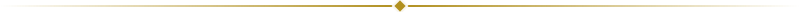

<!-- ===================== HEADER ===================== -->

 

<picture>
  <source media="(prefers-color-scheme: dark)" srcset="https://raw.githubusercontent.com/thehamzaarshad/thehamzaarshad/main/assets/banner-dark.svg" />
  
</picture>

<picture>
  <source media="(prefers-color-scheme: dark)" srcset="https://raw.githubusercontent.com/thehamzaarshad/thehamzaarshad/main/assets/typing-dark.svg" />
  
</picture>

  

<a href="https://github.com/thehamzaarshad">
<picture>
  <source media="(prefers-color-scheme: dark)" srcset="https://hits.sh/github.com/thehamzaarshad.svg?style=for-the-badge&label=PROFILE%20VIEWS&color=DCA54C&labelColor=20161F" />
  
</picture>
</a>
<a href="https://github.com/thehamzaarshad?tab=followers">
<picture>
  <source media="(prefers-color-scheme: dark)" srcset="https://img.shields.io/github/followers/thehamzaarshad?label=FOLLOWERS&style=for-the-badge&logo=github&color=DCA54C&labelColor=20161F&logoColor=DCA54C" />
  
</picture>
</a>

<picture>
  <source media="(prefers-color-scheme: dark)" srcset="https://raw.githubusercontent.com/thehamzaarshad/thehamzaarshad/main/assets/divider-dark.svg" />
  
</picture>

<!-- ===================== ABOUT ===================== -->

<h2 align="center">
<picture>
  <source media="(prefers-color-scheme: dark)" srcset="https://raw.githubusercontent.com/thehamzaarshad/thehamzaarshad/main/assets/heading-about-me-dark.svg" />
  
</picture>
</h2>

- 💼 I work as **[your role]** at **[company / university / freelance]**
- 🔭 Currently working on **[project or focus]**
- 🌱 Currently learning **[technology]**
- 📍 Based in **[city, country]**

<picture>
  <source media="(prefers-color-scheme: dark)" srcset="https://raw.githubusercontent.com/thehamzaarshad/thehamzaarshad/main/assets/skill-python-dark.svg" />
  
</picture>
<picture>
  <source media="(prefers-color-scheme: dark)" srcset="https://raw.githubusercontent.com/thehamzaarshad/thehamzaarshad/main/assets/skill-javascript-dark.svg" />
  
</picture>
<picture>
  <source media="(prefers-color-scheme: dark)" srcset="https://raw.githubusercontent.com/thehamzaarshad/thehamzaarshad/main/assets/skill-git-dark.svg" />
  
</picture>

 

<a href="https://github.com/thehamzaarshad"><picture>
  <source media="(prefers-color-scheme: dark)" srcset="https://raw.githubusercontent.com/thehamzaarshad/thehamzaarshad/main/assets/social-github-dark.svg" />
  
</picture></a>
<a href="https://linkedin.com/in/your-profile"><picture>
  <source media="(prefers-color-scheme: dark)" srcset="https://raw.githubusercontent.com/thehamzaarshad/thehamzaarshad/main/assets/social-linkedin-dark.svg" />
  
</picture></a>
<a href="mailto:your@email.com"><picture>
  <source media="(prefers-color-scheme: dark)" srcset="https://raw.githubusercontent.com/thehamzaarshad/thehamzaarshad/main/assets/social-email-dark.svg" />
  
</picture></a>

<picture>
  <source media="(prefers-color-scheme: dark)" srcset="https://raw.githubusercontent.com/thehamzaarshad/thehamzaarshad/main/assets/divider-dark.svg" />
  
</picture>

<!-- ===================== CONTRIBUTION PULSE ===================== -->

<h2 align="center">
<picture>
  <source media="(prefers-color-scheme: dark)" srcset="https://raw.githubusercontent.com/thehamzaarshad/thehamzaarshad/main/assets/heading-contribution-pulse-dark.svg" />
  
</picture>
</h2>

<picture>
  <source media="(prefers-color-scheme: dark)" srcset="https://raw.githubusercontent.com/thehamzaarshad/thehamzaarshad/main/assets/ecg-dark.svg" />
  
</picture>

An ICU bedside monitor driven by my real GitHub activity. It behaves like a real heart: it rests while I'm idle, speeds up while I work, and recovers afterwards. Updates every ~5 minutes via GitHub Actions.

<b>🩺 How to read my vitals</b>

 

| Vital | What it means | How it is computed |
| ----- | ------------- | ------------------ |
| **HR** (BPM) | Live effort | Rests at 68. Every recent event (push, PR, review, issue) ramps HR up within minutes, and it recovers over ~35 minutes after I stop |
| **SpO2** (%) | Consistency | Active days in the last 7 days (70%) and last 30 days (30%), dips slightly while working |
| **NIBP** (mmHg) | Workload pressure | Baseline from 7-day average load, rises with current effort |
| **RESP** (rpm) | Breathing | Rises with current effort. The breathing sway on the ECG follows it |
| **HRV** (RMSSD) | Variability | RMSSD of day-to-day contribution changes over 14 days |
| **NEWS2** | Overall early-warning score | The NHS NEWS2 banding applied to HR, SpO2, systolic BP and RR |

**Rhythms:** normal sinus rhythm at rest, tachycardia while working hard, then back to normal. After 2+ days of no activity: bradycardia → irregular rhythm (PVCs) → **asystole** after 7 days with no activity.

**Alarms:** NEWS2 5-6 = *urgent review*, NEWS2 7+ = *escalate*. The bottom strip shows my last 30 days of contributions.

<picture>
  <source media="(prefers-color-scheme: dark)" srcset="https://raw.githubusercontent.com/thehamzaarshad/thehamzaarshad/main/assets/divider-dark.svg" />
  
</picture>

<!-- ===================== GITHUB ENGINEERING STATS ===================== -->

<h2 align="center">
<picture>
  <source media="(prefers-color-scheme: dark)" srcset="https://raw.githubusercontent.com/thehamzaarshad/thehamzaarshad/main/assets/heading-github-engineering-stats-dark.svg" />
  
</picture>
</h2>

<a href="https://streak-stats.demolab.com/">
<picture>
  <source media="(prefers-color-scheme: dark)" srcset="https://streak-stats.demolab.com/?user=thehamzaarshad&hide_border=false&border=DCA54C&background=20161F&ring=DCA54C&fire=DCA54C&currStreakNum=DCA54C&sideNums=DCA54C&currStreakLabel=DCA54C&sideLabels=DCA54C&dates=DCA54C&mode=daily&locale=en&disable_animations=true" />
  
</picture>
</a>
<picture>
  <source media="(prefers-color-scheme: dark)" srcset="https://github-stats-extended.vercel.app/api/top-langs/?username=thehamzaarshad&layout=compact&card_width=420&hide_border=false&border_color=DCA54C&title_color=DCA54C&text_color=DCA54C&bg_color=20161F&custom_title=Technology%20Footprint" />
  
</picture>

<picture>
  <source media="(prefers-color-scheme: dark)" srcset="https://raw.githubusercontent.com/thehamzaarshad/thehamzaarshad/main/assets/divider-dark.svg" />
  
</picture>

<!-- ===================== CONTRIBUTION ANALYTICS ===================== -->

<h2 align="center">
<picture>
  <source media="(prefers-color-scheme: dark)" srcset="https://raw.githubusercontent.com/thehamzaarshad/thehamzaarshad/main/assets/heading-contribution-analytics-dark.svg" />
  
</picture>
</h2>

<a href="https://github.com/fabianocouto/github-readme-activity-graph">
<picture>
  <source media="(prefers-color-scheme: dark)" srcset="https://fabianocouto-activity-graph.vercel.app/graph/?username=thehamzaarshad&hide_border=true&bg_color=20161F&color=DCA54C&line=DCA54C&point=DCA54C&area=true&area_color=DCA54C" />
  
</picture>
</a>

<picture>
  <source media="(prefers-color-scheme: dark)" srcset="https://raw.githubusercontent.com/thehamzaarshad/thehamzaarshad/main/assets/divider-dark.svg" />
  
</picture>

<!-- ===================== CONTRIBUTION ACTIVITY ===================== -->

<h2 align="center">
<picture>
  <source media="(prefers-color-scheme: dark)" srcset="https://raw.githubusercontent.com/thehamzaarshad/thehamzaarshad/main/assets/heading-contribution-activity-dark.svg" />
  
</picture>
</h2>

<picture>
  <source media="(prefers-color-scheme: dark)" srcset="https://raw.githubusercontent.com/thehamzaarshad/thehamzaarshad/output/github-contribution-grid-snake-dark.svg">
  <source media="(prefers-color-scheme: light)" srcset="https://raw.githubusercontent.com/thehamzaarshad/thehamzaarshad/output/github-contribution-grid-snake.svg">
  
</picture>

<picture>
  <source media="(prefers-color-scheme: dark)" srcset="https://raw.githubusercontent.com/thehamzaarshad/thehamzaarshad/main/assets/footer-dark.svg" />
  
</picture>

