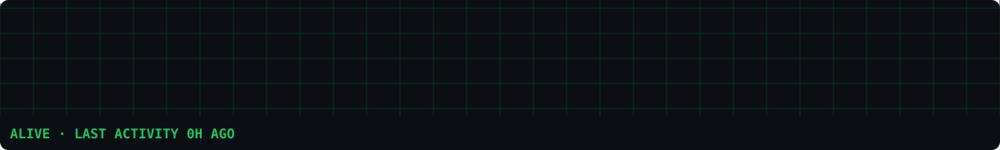

<!-- ===================== HEADER ===================== -->

<picture>
  <source media="(prefers-color-scheme: dark)" srcset="https://capsule-render.vercel.app/api?type=rounded&color=1A160C&height=190&text=HAMZA%20ARSHAD&fontColor=DCA54C&fontSize=44&fontAlignY=50&stroke=4A4024&strokeWidth=2" />
  
</picture>

<h1>🔥 Hi, I'm <a href="https://github.com/thehamzaarshad">Hamza</a> </h1>

<a href="https://git.io/typing-svg">
<picture>
  <source media="(prefers-color-scheme: dark)" srcset="https://readme-typing-svg.herokuapp.com?font=Poppins&weight=600&size=20&duration=4500&pause=5000&color=DCA54C&center=true&vCenter=true&width=435&lines=Assalam-o-Alaikum!" />
  
</picture>
</a>

  

<a href="https://github.com/thehamzaarshad">
<picture>
  <source media="(prefers-color-scheme: dark)" srcset="https://komarev.com/ghpvc/?username=thehamzaarshad&label=PROFILE%20VIEWS&color=DCA54C&labelColor=4A4024&style=for-the-badge" />
  
</picture>
</a>
<a href="https://github.com/thehamzaarshad?tab=followers">
<picture>
  <source media="(prefers-color-scheme: dark)" srcset="https://img.shields.io/github/followers/thehamzaarshad?label=FOLLOWERS&style=for-the-badge&logo=github&color=DCA54C&labelColor=4A4024&logoColor=F3EEDD" />
  
</picture>
</a>

<picture>
  <source media="(prefers-color-scheme: dark)" srcset="https://capsule-render.vercel.app/api?type=rect&color=0:1A160C,50:DCA54C,100:1A160C&height=2" />
  
</picture>

<!-- ===================== ABOUT ===================== -->

<h2 align="center">
<picture>
  <source media="(prefers-color-scheme: dark)" srcset="https://capsule-render.vercel.app/api?type=rounded&color=28220F&height=64&text=About%20Me&fontColor=DCA54C&fontSize=24&fontAlign=50&fontAlignY=52" />
  
</picture>
</h2>

<!-- EDIT: replace the placeholders below with your own details -->
- 💼 I work as **[your role]** at **[company / university / freelance]**
- 🔭 Currently working on **[project or focus]**
- 🌱 Currently learning **[technology]**
- 📍 Based in **[city, country]**

<!-- EDIT: keep only what you actually use -->
<picture>
  <source media="(prefers-color-scheme: dark)" srcset="https://img.shields.io/badge/Python-28220F?style=for-the-badge&logo=python&logoColor=DCA54C" />
  
</picture>
<picture>
  <source media="(prefers-color-scheme: dark)" srcset="https://img.shields.io/badge/JavaScript-28220F?style=for-the-badge&logo=javascript&logoColor=DCA54C" />
  
</picture>
<picture>
  <source media="(prefers-color-scheme: dark)" srcset="https://img.shields.io/badge/Git-28220F?style=for-the-badge&logo=git&logoColor=DCA54C" />
  
</picture>

<!-- EDIT: add your real links -->
<a href="https://github.com/thehamzaarshad">
<picture>
  <source media="(prefers-color-scheme: dark)" srcset="https://img.shields.io/badge/GitHub-thehamzaarshad-DCA54C?style=for-the-badge&logo=github&logoColor=1A160C" />
  
</picture>
</a>
<a href="https://linkedin.com/in/your-profile">
<picture>
  <source media="(prefers-color-scheme: dark)" srcset="https://img.shields.io/badge/LinkedIn-your--profile-DCA54C?style=for-the-badge&logo=linkedin&logoColor=1A160C" />
  
</picture>
</a>
<a href="mailto:your@email.com">
<picture>
  <source media="(prefers-color-scheme: dark)" srcset="https://img.shields.io/badge/Email-your@email.com-DCA54C?style=for-the-badge&logo=gmail&logoColor=1A160C" />
  
</picture>
</a>

<picture>
  <source media="(prefers-color-scheme: dark)" srcset="https://capsule-render.vercel.app/api?type=rect&color=0:1A160C,50:DCA54C,100:1A160C&height=2" />
  
</picture>

<!-- ===================== CONTRIBUTION PULSE ===================== -->

<h2 align="center">
<picture>
  <source media="(prefers-color-scheme: dark)" srcset="https://capsule-render.vercel.app/api?type=rounded&color=28220F&height=64&text=Contribution%20Pulse&fontColor=DCA54C&fontSize=24&fontAlign=50&fontAlignY=52" />
  
</picture>
</h2>

An ICU bedside monitor driven by my real GitHub activity. Refreshes every 3 hours via GitHub Actions.

<b>🩺 How to read my vitals</b>

 

| Vital | What it means | How it is computed |
| ----- | ------------- | ------------------ |
| **HR** (BPM) | Current coding intensity | Weighted activity score (pushes, PRs, reviews, issues) with a 30-hour exponential decay |
| **SpO2** (%) | Consistency | Active days in the last 7 days (70%) and last 30 days (30%) |
| **NIBP** (mmHg) | Workload pressure | Systolic = 7-day average daily load, diastolic = 30-day baseline |
| **RESP** (rpm) | Pace | Active days in the last 30 days |
| **HRV** (RMSSD) | Variability | RMSSD of day-to-day contribution changes over 14 days |
| **NEWS2** | Overall early-warning score | The NHS NEWS2 banding applied to HR, SpO2, systolic BP and RR |

**Rhythms:** normal sinus rhythm while I'm active → bradycardia → irregular rhythm (PVCs) as days go quiet → **asystole** after 7 days with no activity.

**Alarms:** NEWS2 5-6 = *urgent review*, NEWS2 7+ = *escalate*. The bottom strip shows my last 30 days of contributions.

<picture>
  <source media="(prefers-color-scheme: dark)" srcset="https://capsule-render.vercel.app/api?type=rect&color=0:1A160C,50:DCA54C,100:1A160C&height=2" />
  
</picture>

<!-- ===================== GITHUB ENGINEERING STATS ===================== -->

<h2 align="center">
<picture>
  <source media="(prefers-color-scheme: dark)" srcset="https://capsule-render.vercel.app/api?type=rounded&color=28220F&height=64&text=GitHub%20Engineering%20Stats&fontColor=DCA54C&fontSize=24&fontAlign=50&fontAlignY=52" />
  
</picture>
</h2>

<a href="https://streak-stats.demolab.com/">
<picture>
  <source media="(prefers-color-scheme: dark)" srcset="https://streak-stats.demolab.com/?user=thehamzaarshad&hide_border=false&border=4A4024&background=1A160C&ring=DCA54C&fire=DCA54C&currStreakNum=E8C55A&sideNums=F3EEDD&currStreakLabel=DCA54C&sideLabels=A0967D&dates=A0967D&mode=daily&locale=en&disable_animations=true" />
  
</picture>
</a>
<picture>
  <source media="(prefers-color-scheme: dark)" srcset="https://github-stats-extended.vercel.app/api/top-langs/?username=thehamzaarshad&layout=compact&card_width=420&hide_border=false&border_color=4A4024&title_color=DCA54C&text_color=F3EEDD&bg_color=1A160C&custom_title=Technology%20Footprint" />
  
</picture>

<picture>
  <source media="(prefers-color-scheme: dark)" srcset="https://capsule-render.vercel.app/api?type=rect&color=0:1A160C,50:DCA54C,100:1A160C&height=2" />
  
</picture>

<!-- ===================== CONTRIBUTION ANALYTICS ===================== -->

<h2 align="center">
<picture>
  <source media="(prefers-color-scheme: dark)" srcset="https://capsule-render.vercel.app/api?type=rounded&color=28220F&height=64&text=Contribution%20Analytics&fontColor=DCA54C&fontSize=24&fontAlign=50&fontAlignY=52" />
  
</picture>
</h2>

<a href="https://github.com/ashutosh00710/github-readme-activity-graph">
<picture>
  <source media="(prefers-color-scheme: dark)" srcset="https://fabianocouto-activity-graph.vercel.app/graph/?username=thehamzaarshad&hide_border=true&bg_color=1A160C&color=F3EEDD&line=DCA54C&point=E8C55A&area=true&area_color=DCA54C" />
  
</picture>
</a>

<picture>
  <source media="(prefers-color-scheme: dark)" srcset="https://capsule-render.vercel.app/api?type=rect&color=0:1A160C,50:DCA54C,100:1A160C&height=2" />
  
</picture>

<!-- ===================== CONTRIBUTION ACTIVITY ===================== -->

<h2 align="center">
<picture>
  <source media="(prefers-color-scheme: dark)" srcset="https://capsule-render.vercel.app/api?type=rounded&color=28220F&height=64&text=Contribution%20Activity&fontColor=DCA54C&fontSize=24&fontAlign=50&fontAlignY=52" />
  
</picture>
</h2>

<picture>
  <source media="(prefers-color-scheme: dark)" srcset="https://raw.githubusercontent.com/thehamzaarshad/thehamzaarshad/output/github-contribution-grid-snake-dark.svg">
  <source media="(prefers-color-scheme: light)" srcset="https://raw.githubusercontent.com/thehamzaarshad/thehamzaarshad/output/github-contribution-grid-snake.svg">
  
</picture>

<picture>
  <source media="(prefers-color-scheme: dark)" srcset="https://capsule-render.vercel.app/api?type=rounded&color=1A160C&height=70&stroke=4A4024&strokeWidth=2" />
  
</picture>

